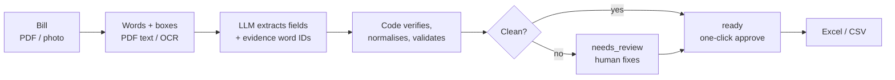

# Invoice Review for Indian CA Firms

A human-in-the-loop pipeline that reads GST invoices and receipts (PDF, scan, phone photo), extracts key fields, validates them with deterministic rules, shows where each value came from on the page, and sends doubtful cases to a person for review. Free tools only: local PDF text + OCR and free-tier LLM APIs. No Azure.

> Models extract evidence. Code decides policy. The human owns the decision.

Built as Project 1 ("Invoice and Receipt Extractor") of the [100 Days of AI Engineering](https://ai-engineer-roadmap-2026.vercel.app/100-days/projects/) roadmap, using Dave Ebbelaar's [e2e-invoice-review](https://github.com/daveebbelaar/e2e-invoice-review) as the structural reference.

## How it works

## Branches

| Branch | Purpose |
|---|---|
| `main` | Planning: brief, rules, architecture, stack, evaluation, security, decisions. No application code |
| `development` | The implementation, built in small slices |

## Docs

| Doc | Contents |
|---|---|
| [Client brief](docs/client-brief.md) | Who it is for, the problem, scope |
| [Policy rules](docs/policy-rules.md) | GST validation rules, statuses, confidence |
| [Architecture](docs/architecture.md) | Diagrams: components, pipeline, request flow, lifecycle, data model |
| [Tech stack](docs/tech-stack.md) | Tools and open items |
| [Decisions](docs/decisions.md) | Why each major choice was made |
| [Evaluation](docs/evaluation.md) | Corpus, metrics, experiments |
| [Security](docs/security.md) | Threats and checklist |
| [Roadmap](docs/roadmap.md) | Milestones and exit criteria |
| [Build-along](docs/build-along.md) | Step-by-step build log |

Working with Claude Code: project rules are in [CLAUDE.md](CLAUDE.md).

## Prerequisites

Python 3.12+, [uv](https://docs.astral.sh/uv/), Node.js 22+, pnpm, and a free Gemini API key (NVIDIA key optional).

## Setup

Setup commands are added in milestone M1. Copy `backend/.env.example` to `backend/.env` and `frontend/.env.example` to `frontend/.env`, then add your keys.

## Results

_Filled in after milestone M5._

## Data warning

Free-tier LLM APIs may use prompts for training. Use only fictional, synthetic or fully redacted documents.
