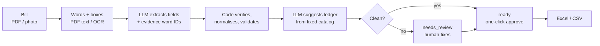

# Invoice Review for Indian CA Firms

A human-in-the-loop pipeline that reads GST invoices and receipts (PDF, scan, phone photo), extracts key fields, validates them with deterministic rules, shows where each value came from on the page, and sends doubtful cases to a person for review. Free tools only: local PDF text + OCR and free-tier LLM APIs. No Azure.

> Models extract evidence. Code decides policy. The human owns the decision.

Built as Project 1 ("Invoice and Receipt Extractor") of the [100 Days of AI Engineering](https://ai-engineer-roadmap-2026.vercel.app/100-days/projects/) roadmap, using Dave Ebbelaar's [e2e-invoice-review](https://github.com/daveebbelaar/e2e-invoice-review) as the structural reference.

## How it works

## Branches

| Branch | Purpose |
|---|---|
| `main` | Planning: brief, rules, architecture, stack, evaluation, security, decisions. No application code |
| `development` | The implementation, built in small slices |

## Docs

| Doc | Contents |
|---|---|
| [Client brief](docs/client-brief.md) | Who it is for, the problem, scope |
| [Policy rules](docs/policy-rules.md) | GST validation rules, statuses, confidence |
| [Architecture](docs/architecture.md) | Diagrams: components, pipeline, request flow, lifecycle, data model |
| [API and pipeline](docs/api-and-pipeline.md) | Endpoints, response shape, status codes, pipeline steps |
| [Tech stack](docs/tech-stack.md) | Tools compared with the reference build |
| [Free-tier limits](docs/free-tier-limits.md) | API calls per document, quotas, behaviour at the limit |
| [Decisions](docs/decisions.md) | Why each major choice was made |
| [Evaluation](docs/evaluation.md) | Corpus, metrics, experiments |
| [Security](docs/security.md) | Threats and checklist |
| [Roadmap](docs/roadmap.md) | Milestones and exit criteria |
| [Todos](docs/todos.md) | Step-by-step checklist and progress |
| [Build-along](docs/build-along.md) | Step-by-step build log |

Working with Claude Code: project rules are in [CLAUDE.md](CLAUDE.md), with [backend](backend/CLAUDE.md) and [frontend](frontend/CLAUDE.md) additions.

## Prerequisites

Python 3.12+, [uv](https://docs.astral.sh/uv/), Node.js 22+, pnpm, and a free Gemini API key (NVIDIA key optional).

## Setup

Setup commands are added in milestone M1. Copy `backend/.env.example` to `backend/.env` and `frontend/.env.example` to `frontend/.env`, then add your keys.

## Results

Measured on **30 synthetic documents** (18 dev, 12 test) with Gemini `gemini-3.5-flash-lite`, 2 November 2026, one run each. Full tables: [`evaluation/results-2026-11-02-test.md`](evaluation/results-2026-11-02-test.md) and the [dev file](evaluation/results-2026-11-02-dev.md). Method and corpus: [`docs/evaluation.md`](docs/evaluation.md).

**Read these numbers as a rough guide.** The test split has 12 documents, so one document is 8 % of a figure. The documents are synthetic, clean by design (the hardest are a blurred scan, a tilted scan, an 85 dpi scan and a phone photo) and generated by the same script that wrote the ground truth. Prompts, rules and the confidence threshold were tuned on the dev split only; the test split was run once, after that, and nothing was changed afterwards.

**Test split (12 documents)**

| Setup | Field accuracy | Exact-document | Status accuracy | API calls / doc |
|---|---|---|---|---|
| Gemini, reading A only | 100 % (148/148) | 100 % (12/12) | 100 % (12/12) | 2.0 |
| Gemini, A + B on doubt | 100 % (148/148) | 100 % (12/12) | 100 % (12/12) | 2.0 (B ran on 0 of 12) |
| Gemini, A + B always | 100 % (148/148) | 100 % (12/12) | 100 % (12/12) | 3.0 |

Same on all three setups: line items 86.7 % (26/30), ledger 91.7 % (11/12), blocking-error recall and precision 100 % (2 of 2: a total mismatch and a duplicate invoice), provenance 100 % (proxy: the cited words contain the true value), **safety invariant: 0 violations**. Dev split (18 documents, the tuned-on set): field accuracy 99.0 % (99.5 % with B always), status 100 %, line items 97.9 %, ledger 94.4 %, 0 violations.

What the numbers do not say:

- **The second reading showed no benefit on the test split.** Every field was already right, and `on_doubt` never ran. On dev it filled one missing field (sample 23) at the price of one more call and 20-30 s per document. This corpus is too clean to judge it; the default stays `on_doubt`.
- **Only 2 of the 12 test documents carry a blocking error**, so the safety result is thin. On dev, before the `VENDOR_IS_CLIENT` rule, a bill with no vendor GSTIN ended `ready` because the model read the client's GSTIN as the vendor's.
- **Seconds per document are not comparable between runs.** The recorded model time was 3 s per call on dev and 15-25 s per call on test (free-tier latency varied from 1 s to 69 s); that is the service, not the model.
- **Provenance** is a proxy: the corpus has no ground-truth boxes.
- **Failures seen** (mostly OCR spelling in line-item descriptions: `laminat d`, `Postpaid business lans`; a dropped quantity on the 85 dpi scan; a rate read as `2.65` instead of `2,650.00` on the blurred scan, which no rule catches; the ledger of the cafe receipt, `5110` against my `6180`, is ambiguous for a restaurant client). More in the results files and `docs/build-along.md`.
- The confidence threshold (0.70) was set on dev with weak evidence; on the test split no required value was wrong at any confidence, so the test cannot show that it is too low.

Not measured: NVIDIA (postponed, `docs/decisions.md` D15), documents in Hindi, handwriting, real client bills.

## Data warning

Free-tier LLM APIs may use prompts for training. Use only fictional, synthetic or fully redacted documents.
