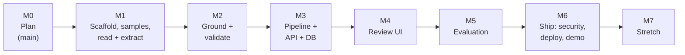

# Roadmap

Milestones with exit criteria. Each milestone is built as small slices on `development`, and each slice is logged in [build-along.md](build-along.md).

| Milestone | Slices | Exit criteria |
|---|---|---|
| **M0 Plan** | Brief, policy, architecture, API, stack, limits, evaluation, security, decisions, CLAUDE.md files | Docs reviewed and committed on `main` |
| **M1 Scaffold, samples, read + extract** | 1. `backend/` uv project and `frontend/` Vite project with pinned deps and lockfiles (like the reference `main`). 2. `config.py` + `.env`. 3. `generate_samples.py` → first 12 synthetic GST invoices / receipts + manifest. 4. Reader (PDF text layer + RapidOCR) in `playground/`. 5. `check_gemini.py`, `check_nvidia.py`. 6. Extraction with evidence IDs in `playground/` | One sample → numbered words with boxes → JSON fields with evidence IDs, printed in the console. Free-tier table in free-tier-limits.md filled in |
| **M2 Ground + validate** | Typed models; grounding; normalisation (Indian dates, amounts); GSTIN; invoice and receipt rules; duplicate key; pytest for these | All rules in policy-rules.md implemented; tests pass offline |
| **M3 Pipeline + API** | `PipelineContext` and steps; second reading + merge; ledger catalog + suggestion; SQLite model, repository, service, routes; cache by hash; correction-email eligibility + draft; export | `curl` upload → document reaches `ready` / `needs_review` with fields, boxes, issues and a ledger suggestion; `409` on illegal approve |
| **M4 Review UI** | Welcome → upload (client picker) → processing → review flow; inbox with filters; page overlay with click-to-highlight; edit, ledger, approve, reject, bulk approve; correction-email dialog; delete; export button | Manual walkthrough of the 4 demo documents works end to end |
| **M5 Evaluation** | Full 36+ corpus with dev / test split; `evaluate_corpus.py`; provider and second-reading experiments; threshold tuning on dev | Results table on the test split in README; safety invariant shows zero violations |
| **M6 Ship** | Password gate; security pass; Dockerfile (SPA + API in one image); deploy with sample data; 3-5 min demo video | Live URL, video, and security checklist all done |
| **M7 Stretch** | Hindi + English, handwritten receipts, GSTR-2B reconciliation, Tally export | Each stretch adds its own samples to the evaluation |

## Demo documents

Four documents carry the demo (like the reference build):

1. Clean intra-state invoice (CGST + SGST) → `ready`, ledger suggested, approve
2. Invalid vendor GSTIN → `needs_review`, checksum fix suggested, correction email drafted
3. Total mismatch → `needs_review`, cannot be approved
4. Fuel receipt (phone photo) → receipt rules, ledger "Fuel and vehicle running", `ready`
